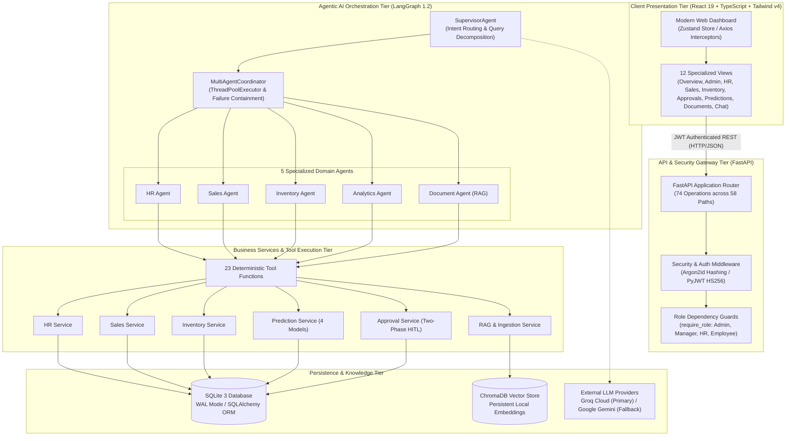
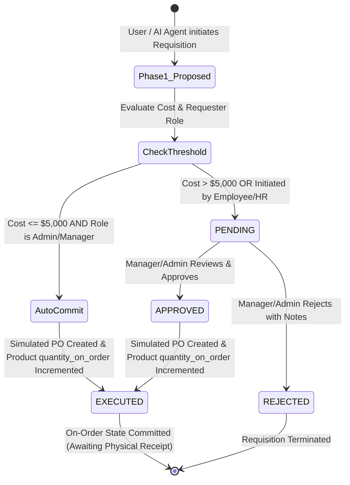

# Agentic AI Integrated Enterprise Automation and Decision Support System

[](https://www.python.org/)
[](https://fastapi.tiangolo.com/)
[](https://langchain-ai.github.io/langgraph/)
[](https://react.dev/)
[](https://www.typescriptlang.org/)
[](https://tailwindcss.com/)
[-brightgreen.svg)]()
[%20%7C%20Oxlint-blueviolet.svg)]()

> A completed development prototype for an autonomous multi-agent enterprise operational and decision-support platform integrating **Human Resources (HR)**, **Sales Operations**, and **Inventory Management** with a **LangGraph Multi-Agent Orchestrator**, private **ChromaDB Document Intelligence (RAG)**, automated **Human-in-the-Loop (HITL) Approvals**, and empirical **Time-Series Predictive Forecasting**. *(Production deployment is pending scheduled hosting rollout).*

---

## Table of Contents
1. [Project Overview](#1-project-overview)
2. [Problem Statement](#2-problem-statement)
3. [Proposed Solution](#3-proposed-solution)
4. [Key Features](#4-key-features)
5. [Complete System Architecture](#5-complete-system-architecture)
6. [Five Specialized AI Agents](#6-five-specialized-ai-agents)
7. [Multi-Agent Execution Workflow](#7-multi-agent-execution-workflow)
8. [RAG and Document Intelligence](#8-rag-and-document-intelligence)
9. [Persistent Conversation Memory](#9-persistent-conversation-memory)
10. [Human-in-the-Loop Approval Workflows](#10-human-in-the-loop-approval-workflows)
11. [Predictive Analytics and Model Comparison](#11-predictive-analytics-and-model-comparison)
12. [HR, Sales, and Inventory Modules](#12-hr-sales-and-inventory-modules)
13. [Authentication and Four-Role RBAC](#13-authentication-and-four-role-rbac)
14. [Technology Stack](#14-technology-stack)
15. [Project Directory Structure](#15-project-directory-structure)
16. [Application Interface & Visual Showcase Plan](#16-application-interface--visual-showcase-plan)
17. [Prerequisites](#17-prerequisites)
18. [Windows PowerShell Installation Instructions](#18-windows-powershell-installation-instructions)
19. [Backend Environment Configuration](#19-backend-environment-configuration)
20. [Database Initialization and Seed Data](#20-database-initialization-and-seed-data)
21. [Backend Startup Instructions](#21-backend-startup-instructions)
22. [Frontend Installation and Startup Instructions](#22-frontend-installation-and-startup-instructions)
23. [API Documentation Links](#23-api-documentation-links)
24. [Testing and Verification Results](#24-testing-and-verification-results)
25. [Master Documentation Links](#25-master-documentation-links)
26. [Limitations and Known Constraints](#26-limitations-and-known-constraints)
27. [Future Enhancements](#27-future-enhancements)
28. [Project Status and Conclusion](#28-project-status-and-conclusion)

---

## 1. Project Overview

> [!NOTE]
> **Development Prototype & Deployment Status:**
> This system is a **completed development prototype and academic research platform**. All backend services, multi-agent workflows, and frontend dashboard views are fully implemented and verified locally. **Production deployment (managed cloud hosting, PostgreSQL migration, and production container orchestration) is pending** and strictly scheduled as the final project phase following academic viva defense.

Traditional Enterprise Resource Planning (ERP) applications isolate critical operational data within departmental silos, requiring business leaders to manually extract spreadsheets and reconcile cross-departmental impacts. Conversely, applying unconstrained Large Language Models (LLMs) directly to operational databases introduces severe hallucination risks, potential SQL injection, and unauthorized data leakage.

The **Agentic AI Integrated Enterprise and Decision Support System** resolves this fundamental tension by establishing a **deterministic business foundation governed by an intelligent multi-agent conversational supervisor**.

The system provides a modern single-page dashboard built with React 19 and Tailwind CSS v4, backed by a high-performance FastAPI service. Employees, HR officers, operational managers, and enterprise administrators interact through role-restricted interfaces and natural language dialogue to manage employee lifecycles, monitor sales pipelines, track real-time stock levels, query internal knowledge bases, and review predictive revenue forecasts.

### Core Architectural Philosophy: Deterministic Computation, Conversational Reasoning
Large Language Models are strictly restricted to natural language comprehension, intent classification, task routing, and markdown synthesis. All calculations, database mutations, policy validations, and statistical forecasts are executed by compiled Python service routines. The LLM never writes raw SQL and never calculates financial or inventory figures directly.

---

## 2. Problem Statement

1. **Departmental Data Silos:** HR headcount, sales velocity, and inventory depletion are tracked in fragmented systems, making real-time cross-departmental correlation slow and error-prone.
2. **Slow, Opaque Approval Bottlenecks:** Purchase requisitions and employee leave requests often rely on disjointed email chains, lacking auditability and dynamic budget enforcement.
3. **The LLM Hallucination & Security Dilemma:** Generic Text-to-SQL approaches allow LLMs to generate malformed queries, access unauthorized salary or revenue figures, and produce inaccurate arithmetic calculations.
4. **Lack of Operational Predictive Foresight:** Small-to-medium enterprises frequently lack accessible machine learning tools to forecast quarterly revenue and identify stockout risks before replenishment lead times elapse.

---

## 3. Proposed Solution

This system combines deterministic relational architecture with LangGraph agentic orchestration:
- **Hierarchical Supervisor Multi-Agent System:** A central `SupervisorAgent` parses natural language queries, formulates execution plans, and coordinates 5 specialized domain agents.
- **Deterministic Tool Calling:** Sub-agents execute 23 registered strongly typed Python tools through SQLAlchemy 2.0 services.
- **Private ChromaDB RAG Intelligence:** Enterprise policy documents are parsed, chunked, and embedded locally into ChromaDB with metadata-scoped role filtering.
- **Automated Human-in-the-Loop (HITL) Governance:** A two-phase commit approval engine forces high-risk actions (purchase requisitions > $5,000 or by non-executives) into a pending review queue with an immutable audit log.
- **Empirical Time-Series Forecasting:** A statistical forecasting engine evaluates 4 competing models (Naive, SMA-3, OLS, Holt's) on out-of-sample data, refits the winner, and projects a 3-month sales horizon with standard-error bounds.

---

## 4. Key Features

- **Multi-Agent Conversational Workspace:** Natural language interface capable of answering complex, cross-department queries across HR, Sales, Inventory, and Analytics.
- **Role-Based Access Control (RBAC):** Strict 4-role hierarchy (`Admin`, `Manager`, `HR`, `Employee`) enforced at the JWT, API route, tool execution, and frontend navigation layers.
- **Document Intelligence (RAG):** Fast semantic retrieval over corporate documents with binary magic-byte validation (`%PDF-`, `PK\x03\x04`) and cited source attribution.
- **Stateful Conversation Memory:** Persistent database storage of multi-turn dialogues with contextual reference resolution.
- **Human-in-the-Loop Requisition Workflow:** Automated purchase requisition preparation with review, approval, and execution tracking.
- **Automated Inventory Risk Detection:** Lead-time demand runout formulas automatically tag SKUs as `CRITICAL`, `MODERATE`, or `LOW` risk.
- **Enterprise HR & Leave Lifecycle:** Employee directory management, department tracking, leave applications, and automatic balance deductions.
- **Sales & Order Management:** Live order tracking across operational statuses (`PENDING`, `PROCESSING`, `SHIPPED`, `COMPLETED`, `CANCELLED`).
- **Modern Responsive Dashboard:** Built with React 19, TypeScript, Tailwind CSS v4, Lucide icons, and Zustand state persistence.

---

## 5. Complete System Architecture

The application is structured into five distinct operational tiers:



---

## 6. Five Specialized AI Agents

The multi-agent system uses specialized domain agents registered with the `MultiAgentCoordinator`:

| Specialized Agent | Source Implementation | Handled Tools | Primary Operational Responsibilities |
| :--- | :--- | :---: | :--- |
| **HR Agent** | `backend/app/agents/specialized/hr_agent.py` | 5 Tools | Queries employee profiles, departmental rosters, leave balances, and pending leave requests. |
| **Sales Agent** | `backend/app/agents/specialized/sales_agent.py` | 4 Tools | Inspects live order states, customer records, order items, and operational sales revenue. |
| **Inventory Agent** | `backend/app/agents/specialized/inventory_agent.py` | 4 Tools | Checks stock levels, alerts on low-stock thresholds, reviews stock movement history, and prepares purchase requisitions. |
| **Analytics Agent** | `backend/app/agents/specialized/analytics_agent.py` | 5 Tools | Aggregates cross-department metrics, runs 3-month sales forecasts, assesses SKU shortage risks, and checks approval statuses. |
| **Document Agent** | `backend/app/agents/specialized/document_agent.py` | 3 Tools | Performs semantic vector searches in ChromaDB, retrieves relevant policy paragraphs, and synthesizes cited answers. |

---

## 7. Multi-Agent Execution Workflow

When a natural language query is submitted to `/api/agents/chat`:
1. **Context Resolution:** The supervisor checks the prior 5 conversation messages in the database to resolve anaphoric pronouns (e.g., *"What about Engineering?"*).
2. **Supervisor Planning:** The `SupervisorAgent` classifies intent and constructs a `SupervisorDecision` containing structured `PlannedTool` invocations.
3. **Deduplication:** The `MultiAgentCoordinator` deduplicates identical tool calls based on tool name and argument hashes.
4. **Parallel Execution:** Non-conflicting agent tasks are dispatched concurrently using a Python `ThreadPoolExecutor`.
5. **Session Isolation:** Each worker thread receives an independent, thread-local SQLAlchemy database session (`SessionLocal()`), ensuring database thread safety.
6. **Bounded Failure Containment:** Sub-agent executions are governed by `AGENT_TIMEOUT_SECONDS=60`. If an individual agent times out or throws an exception, its error is isolated, and successful peer outputs are preserved.
7. **Synthesis:** The supervisor synthesizes tool outputs into a coherent markdown response. If the external LLM is unreachable, the system automatically falls back to deterministic rule-based formatting.

---

## 8. RAG and Document Intelligence

The Retrieval-Augmented Generation subsystem enables secure semantic question-answering over organizational documentation:

- **Format Support:** Plain text (`.txt`), Adobe PDF (`.pdf`), and Microsoft Word (`.docx`).
- **Binary Signature Validation:** Validates file magic headers (`%PDF-` for PDFs, `PK\x03\x04` for Word archives) to prevent file extension spoofing.
- **Recursive Chunking:** Segments documents in `backend/app/services/document_parser.py` using hierarchical delimiter splitting (`\n\n`, `\n`, `. `, `? `, `! `, `; `, `, `, ` `) with `chunk_size = 600` characters and `chunk_overlap = 100` characters to preserve semantic coherence across chunk boundaries.
- **ChromaDB Vector Store:** Embeds chunks locally into persistent ChromaDB collections using dense cosine similarity indexing.
- **RBAC Filtering:** Queries are tagged with the requester's role. Employees can only search public and department-specific policies, while Managers and Administrators have organization-wide access.
- **Grounded Citations:** LLM synthesis prompts mandate bracketed source citations (`[Source: Document.pdf (Chunk N)]`), ensuring auditable attribution.

---

## 9. Persistent Conversation Memory

Conversations are permanently tracked in the relational database:
- **`conversations` Entity:** Tracks thread identity, user ownership, autogenerated descriptive title, and creation timestamps.
- **`conversation_messages` Entity:** Stores every prompt and response, including execution metadata: tools invoked, departments consulted, vector citations, and response latencies.
- **Dynamic Thread Resumption:** Users can resume past conversations; the supervisor loads the last 5 messages as context for new queries.
- **Privacy Isolation:** User queries are scoped strictly to the authenticated account; employees cannot view or access conversation threads of other users.

---

## 10. Human-in-the-Loop Approval Workflows

To prevent unauthorized corporate commitments, the system implements a strict **Two-Phase Commit pattern**:



- **Mandatory Approval Triggers:**
  - Total requisition value exceeds **$5,000** ($\text{quantity} \times \text{unit\_cost} > \$5,000$).
  - Any requisition initiated by a user with a non-executive role (`Employee` or `HR`).
  - All employee leave applications require HR Specialist or Manager approval.
- **Immutable Audit Trail:** All decisions generate permanent records in the `approval_audits` table, logging reviewer ID, decision notes, pre/post state JSON snapshots, and precise timestamps.

> [!IMPORTANT]
> **Purchase Order Execution vs. Physical Stock Receipt:**
> When a purchase order is approved and executed via `execute_approved_action()`, the system creates a simulated purchase order number (`PO-SIM-REQ-XXXX`) and increments the product's `quantity_on_order` in the database. **Physical warehouse inventory (`quantity_on_hand`) is NOT modified**, and **no inbound stock movement is recorded** at PO approval/execution time because goods are still on order with the supplier. Physical stock is incremented and a `PURCHASE_RECEIPT` movement is recorded only when goods physically arrive at the warehouse dock and are checked in via `inventory_service.stock_in(..., fulfill_on_order=True)`. In addition, external supplier transmission and payment processing are simulated; no live EDI or banking gateways are connected.

---

## 11. Predictive Analytics and Model Comparison

The predictive analytics engine forecasts monthly sales revenue and identifies supply chain risks:

### 1. Sales Revenue Forecasting
- **Historical Dataset:** 6 consecutive monthly periods (`2026-05` to `2026-10`).
- **Chronological Evaluation Split:**
  - **Training Set (4 Months):** `2026-05` through `2026-08` (chronological in-sample fit).
  - **Held-Out Test Set (2 Months):** `2026-09` through `2026-10` (strict out-of-sample evaluation).
- **4 Competing Statistical Models:**
  1. *Naive Baseline:* $\hat{y}_{t+h} = y_t$
  2. *3-Month Simple Moving Average (SMA-3):* $\hat{y}_{t+h} = \frac{1}{3} \sum_{i=0}^2 y_{t-i}$
  3. *Ordinary Least Squares (OLS) Linear Trend:* $\hat{y}_t = \beta_0 + \beta_1 t$
  4. *Holt's Linear Exponential Smoothing:* Decomposes level ($\alpha=0.8$) and trend ($\beta=0.2$).
- **Selection & Refitting:** The model minimizing Root Mean Squared Error (RMSE) on the test split is refit on the full 6-month series to generate 3-month forward projections (`2026-11`, `2026-12`, `2027-01`) with approximate 80% standard-error confidence intervals.

### 2. Inventory Replenishment Risk Scoring
For each SKU, the engine calculates:
- Daily sales velocity: $\bar{d} = \frac{\text{Sales Units in Window}}{\text{Window Days}}$
- Lead-time demand: $\text{LTD} = \bar{d} \times \text{Lead Time Days}$
- Estimated runout time: $T_{\text{runout}} = \frac{Q_{\text{on\_hand}}}{\bar{d}}$
- **Risk Categorization:**
  - **CRITICAL:** $Q_{\text{on\_hand}} \le \text{Reorder Point}$ OR $T_{\text{runout}} \le \text{Lead Time Days}$.
  - **MODERATE:** $Q_{\text{on\_hand}} \le 1.5 \times \text{Reorder Point}$.
  - **LOW:** Inventory comfortably covers projected lead-time replenishment cycles.

---

## 12. HR, Sales, and Inventory Modules

### Human Resources (HR)
- **Employee Master:** Full lifecycle tracking (name, email, department, job title, date of joining, status).
- **Leave Management:** Annual, Sick, and Casual leave allowances; balance decrements on approval; multi-state leave tracking (`PENDING`, `APPROVED`, `REJECTED`, `CANCELLED`).
- **Department Metrics:** Real-time headcount distribution and leave utilization reporting.

### Sales Operations
- **Customer Master:** Customer directory, credit terms, and contact records.
- **Order Lifecycle:** Multi-item orders with dynamic status tracking (`PENDING`, `PROCESSING`, `SHIPPED`, `COMPLETED`, `CANCELLED`).
- **Revenue Analytics:** Aggregation of operational order totals and historical sales data.

### Inventory Management
- **Product Catalog:** SKU, category, unit price, cost price, stock on hand, stock on order, reorder points, reorder quantities, and supplier lead times.
- **Stock Movement Ledger:** Append-only transaction records for `PURCHASE_RECEIPT`, `SALES_DISPATCH`, and `CORRECTION`.
- **Low Stock Alerts:** Automated threshold monitoring triggering replenishment warnings.

---

## 13. Authentication and Four-Role RBAC

The system employs industry-standard cryptographic security:
- **Argon2id Password Hashing:** Configured with `time_cost=3`, `memory_cost=65536` KiB (64 MB), and `parallelism=4`, providing hardware and GPU brute-force resistance.
- **Stateless JWT Tokens:** Signed using HMAC-SHA256 (`HS256`) with a 60-minute expiration cycle.
- **Role vs. Designation Separation:** Application permissions are tied to `User.role` (`admin`, `manager`, `hr`, `employee`), decoupled from organizational job titles (`Employee.job_title`).

### 4-Role Permission Matrix

| Operational Capability | Admin | Manager | HR Specialist | Employee |
| :--- | :---: | :---: | :---: | :---: |
| **Manage Users & Reset Roles** | Yes | No | No | No |
| **View Audit & Security Logs** | Yes | No | No | No |
| **View Cross-Dept KPI Analytics** | Yes | Yes | No | No |
| **View Sales Revenue & Forecasts** | Yes | Yes | No | No |
| **Approve Purchase Requisitions** | Yes | Yes | No | No |
| **Approve Employee Leave Requests** | Yes | Yes | Yes | No |
| **Manage Employee Catalog** | Yes | No | Yes | No |
| **Upload Company Policy Documents** | Yes | Yes | Yes | No |
| **Execute AI Multi-Agent Chat** | Full | Full | Full | Self-Service |
| **Search Knowledge Base (RAG)** | All Docs | All Docs | HR & Public | Public & Dept |
| **Submit Personal Leave Request** | Yes | Yes | Yes | Yes |
| **View Personal Profile & History** | Yes | Yes | Yes | Yes |

---

## 14. Technology Stack

| Layer | Technology | Version | Purpose |
| :--- | :--- | :---: | :--- |
| **Backend Framework** | FastAPI | 0.111.0 | Asynchronous REST API controllers and dependency injection |
| **ASGI Web Server** | Uvicorn | 0.30.0 | High-concurrency production ASGI server |
| **Data Validation** | Pydantic v2 | 2.7.0 | Strongly typed request/response schemas and settings |
| **Database ORM** | SQLAlchemy | 2.0.30 | Enterprise object-relational mapping and connection management |
| **Database Engine** | SQLite 3 (WAL Mode) | 3.x | High-concurrency relational storage with Write-Ahead Logging |
| **Schema Migrations** | Alembic | 1.20.x | Separate operational and historical migration environments |
| **Agent Orchestration** | LangGraph | 1.2.0 | Stateful DAG multi-agent workflow compilation |
| **Agent Tool Abstraction** | LangChain Core | 1.7.0 | Standardized tool bindings and message abstractions |
| **LLM Inference** | Groq Cloud API | 0.37.0 | High-speed LLM inference (`qwen/qwen3.8-27b`) |
| **LLM Fallback** | Google GenAI | 2.34.0 | Multi-provider resiliency fallback (`gemini-1.5-flash`) |
| **Vector Database** | ChromaDB | 1.5.0 | Persistent local embedding store with metadata filtering |
| **Document Parsing** | PyPDF & python-docx | 6.20 / 1.1 | Binary-validated text extraction from PDF and Word documents |
| **Authentication** | Argon2-cffi & PyJWT | 23.1 / 2.8 | Memory-hard password hashing and signed JWT sessions |
| **Frontend Framework** | React | 19.3.1 | Component-driven single-page application |
| **Language & Tooling** | TypeScript & Vite | 7.0 / 8.3 | Type-safe development and fast module bundling |
| **Styling & Icons** | Tailwind CSS & Lucide | 4.3 / 1.66 | Modern styling engine and accessible iconography |
| **Client State & HTTP** | Zustand & Axios | 5.0 / 1.21 | Lightweight client state store and interceptor-based HTTP client |
| **Testing Framework** | Pytest & HTTPX | 8.2 / 0.27 | Comprehensive unit and integration test execution |
| **Code Linters** | Ruff & Oxlint | 0.4 / 1.89 | Rust-accelerated Python and TypeScript linting |

---

## 15. Project Directory Structure

```text
D:\Projects\Agentic AI Integrated Enterprise and Decision Support System\
├── backend/
│   ├── alembic/                       # Operational Alembic environment and revisions
│   ├── alembic_historical/            # Independent historical Alembic environment
│   ├── alembic.ini
│   ├── alembic_historical.ini
│   ├── app/
│   │   ├── agents/                    # Multi-agent architecture
│   │   │   ├── specialized/           # 5 Domain agents (HR, Sales, Inventory, Analytics, RAG)
│   │   │   ├── tools/                 # 23 registered deterministic tools
│   │   │   ├── coordinator.py         # MultiAgentCoordinator & ThreadPoolExecutor
│   │   │   ├── llm.py                 # Multi-provider LLM factory (Groq / Gemini)
│   │   │   ├── prompts.py             # System prompts and grounding constraints
│   │   │   ├── state.py               # AgentState and PlannedTool Pydantic models
│   │   │   └── supervisor.py          # LangGraph supervisor workflow & routing
│   │   ├── api/                       # 10 mounted routers (62 operations across 57 API paths)
│   │   ├── core/                      # Security, config, bootstrap, and CSV importers
│   │   ├── db/                        # SQLAlchemy base and session configuration
│   │   ├── models/                    # 13 Relational database entities
│   │   ├── schemas/                   # Pydantic request and response schemas
│   │   ├── services/                  # Business logic services (HR, Sales, Inventory, RAG, etc.)
│   │   └── main.py                    # FastAPI application entry point and lifespan
│   ├── tests/                         # V1 and Phase 1 unit/integration tests
│   ├── .env.example                   # Sanitized configuration template
│   └── requirements.txt               # Backend Python dependency specifications
│
├── frontend/
│   ├── src/
│   │   ├── assets/                    # Static branding and icons
│   │   ├── components/                # Modular UI components (Navigation, Layout, Modals)
│   │   ├── pages/                     # 12 Role-specific application views
│   │   ├── services/                  # Axios API communication services
│   │   ├── store/                     # Zustand authentication state store
│   │   ├── App.tsx                    # Route definitions and ProtectedRoute configuration
│   │   └── main.tsx                   # React root entry point
│   ├── package.json                   # Frontend npm dependencies and scripts
│   └── vite.config.ts                 # Vite bundler configuration
│
├── data/
│   ├── enterprise.db                 # Operational SQLite database (WAL)
│   ├── historical.db                 # Optional; not created on application startup
│   ├── backups/                      # Git-ignored verified local DB snapshots
│   ├── raw/                          # Immutable future source drops by source
│   ├── staging/                      # Local staging only; no source imports in Phase 1
│   └── benchmarks/m5/                 # M5 remains outside both databases
├── docs/                              # Comprehensive documentation suite
│   ├── SYSTEM_DOCUMENTATION.md        # Master 20-Section academic technical report
│   ├── ARCHITECTURE.md                # System architecture specification with Mermaid diagrams
│   ├── API_DOCUMENTATION.md           # REST API specification & RBAC matrix
│   ├── VIVA_AND_DEMO_GUIDE.md         # Viva defense Q&A & live demonstration script
│   └── FINAL_DOCUMENTATION_PLAN.md    # Documentation plan and audit report
└── README.md                          # Repository landing page and quickstart guide
```

---

## 16. Application Interface & Visual Showcase Plan

The frontend features 12 dedicated role-tailored pages. Visual assets are organized as a **planned screenshot directory structure** (`docs/screenshots/`) for the upcoming demonstration phase. Currently, no static PNG files are checked into the repository to avoid committing bulky binary files prior to the final viva presentation materials phase.

### Planned Screenshot Catalog (`docs/screenshots/`):
- `01_admin_dashboard.png`: Executive KPI metrics, system health, and cross-department overview.
- `02_manager_predictions.png`: 3-Month sales revenue forecast, model comparison, and SKU shortage risk table.
- `03_manager_approvals.png`: Two-phase commit purchase requisition review and audit log.
- `04_hr_management.png`: Employee directory, departmental headcount charts, and leave review.
- `05_employee_portal.png`: Employee self-service dashboard and leave application interface.
- `06_multi_agent_chat.png`: Conversational multi-agent chat workspace with grounded RAG citations.
- `07_document_intelligence.png`: Knowledge base document upload and semantic search interface.

> [!NOTE]
> Live application views can be inspected by launching the local Vite development server at `http://127.0.0.1:5173`. High-resolution PNG captures will be added to `docs/screenshots/` during Phase 10 (Presentation & Demonstration Materials).

---

## 17. Prerequisites

Before installing the system, ensure the following tools are available on your machine:
- **Operating System:** Windows 10/11, macOS, or Linux (Windows PowerShell instructions provided below).
- **Python:** Python 3.12+ (64-bit).
- **Node.js & npm:** Node.js 18+ LTS (actively tested and verified on Node.js v24.16.0 with npm 11.13.0).
- **Git:** Git 2.30+.
- **AI API Access:** A valid [Groq Cloud API Key](https://console.groq.com/) (primary) or [Google Gemini API Key](https://aistudio.google.com/) (fallback).

---

## 18. Windows PowerShell Installation Instructions

Open Windows PowerShell (Run as Administrator or standard user) and clone the repository:

```powershell
# 1. Clone the repository
git clone https://github.com/Devashree-b-s/agentic-ai-enterprise-automation.git
Set-Location "agentic-ai-enterprise-automation"

# 2. Create and activate a Python virtual environment
python -m venv .venv
.\.venv\Scripts\Activate.ps1

# 3. Upgrade pip and install backend dependencies
python -m pip install --upgrade pip
pip install -r backend/requirements.txt
```

---

## 19. Backend Environment Configuration

Copy the example environment configuration file to create your active `.env`:

```powershell
Copy-Item backend\.env.example backend\.env
```

Open `backend\.env` in your editor and configure your secrets and API keys:

```ini
# ==========================================
# Core Application Configuration
# ==========================================
PROJECT_NAME="Agentic AI Integrated Enterprise and Decision Support System"
ENVIRONMENT="development"
DEBUG=True

# ==========================================
# Security & JWT Authentication
# ==========================================
# Generate a secret: python -c "import secrets; print(secrets.token_urlsafe(32))"
SECRET_KEY="replace-with-a-secure-random-32-byte-secret-key"
ALGORITHM="HS256"
ACCESS_TOKEN_EXPIRE_MINUTES=60

# ==========================================
# Database Configuration
# ==========================================
DATABASE_URL="sqlite:///C:/path/to/project/data/enterprise.db"
HISTORICAL_DATABASE_URL="sqlite:///C:/path/to/project/data/historical.db"

# ==========================================
# AI Provider Configuration
# ==========================================
LLM_PROVIDER="groq"
GROQ_API_KEY="your-actual-groq-api-key"
GROQ_MODEL="qwen/qwen3.8-27b"

GEMINI_API_KEY="your-gemini-api-key"
GEMINI_MODEL="gemini-1.5-flash"

# ==========================================
# Agent Guardrails & Timeouts
# ==========================================
AGENT_MAX_ITERATIONS=10
AGENT_MAX_TOOL_CALLS=15
AGENT_TIMEOUT_SECONDS=60
```

---

## 20. Database Initialization and Seed Data

Configure both SQLite URLs in `backend/.env` as absolute paths. Relative SQLite paths
provided through `DATABASE_URL` are anchored to the active project root. For a fresh
installation, create the operational schema with Alembic. For an existing V1 database,
validate its schema before stamping the initial baseline; never stamp an unvalidated DB:

The active operational database has been validated and upgraded through revision
`a20d5b9e8f41`; its provenance registry is empty. `data/historical.db` remains
uninitialized by design, and normal application startup does not create it.
Phase 2 adds forward-only ingestion tracking revisions; they have not been applied
to the project operational database. Apply migrations explicitly to the intended
database before configuring an ingestion target.

```powershell
# Run from the project root.
Set-Location backend
# Existing V1 enterprise.db: validate and create a verified backup before stamping.
..\.venv\Scripts\python.exe -m app.core.migration_baseline validate
..\.venv\Scripts\python.exe -m app.core.backup_database
..\.venv\Scripts\python.exe -m app.core.migration_baseline stamp

# Create a fresh operational database: omit the V1 validation, backup, and stamp.
# Run this upgrade after the V1 stamp above, or directly for a fresh database.
..\.venv\Scripts\python.exe -m alembic upgrade head

# The historical database is independent and is not created by application startup.
# Run this only when intentionally initializing that database:
..\.venv\Scripts\python.exe -m alembic -c alembic_historical.ini upgrade head

Set-Location ..

# Import baseline operational/demo datasets only after the operational migration.
.\.venv\Scripts\python.exe backend/app/core/import_employees.py
.\.venv\Scripts\python.exe backend/app/core/import_leaves.py
.\.venv\Scripts\python.exe backend/app/core/import_inventory.py
.\.venv\Scripts\python.exe backend/app/core/import_sales.py

# 4. Bootstrap the Initial Administrator Account
# You will be prompted securely for an email and password via interactive input
.\.venv\Scripts\python.exe -m app.core.bootstrap
```

Restore a verified backup only to a new destination file (the destination must not
already exist); validate the restored database before redirecting `DATABASE_URL`:

```powershell
Set-Location backend
..\.venv\Scripts\python.exe -m app.core.backup_database `
  --restore-from "<backup-directory>\enterprise_verified.db" `
  --restore-to "<restore-directory>\enterprise.db"
Set-Location ..
```

### Reusable Dataset Ingestion Foundation

The internal `app.ingestion.IngestionService` supports streaming CSV and XLSX
inputs. It is not exposed as an unauthenticated upload endpoint. Callers must
explicitly configure a target database, allowed source roots, target table schema,
source-to-target mappings, business keys, and a source declaration. The service
validates file format and size, headers, worksheet selection, types, nullability,
malformed rows, and duplicate keys; applies configured transformations; then loads
accepted rows and completes the provenance batch atomically.

Each batch tracks its dataset identifier, original filename, SHA-256, source
declaration, database target, rows read/accepted/rejected, status, mappings, and
validation summary. Identical completed files are idempotent. Failed loads roll
back target rows and can be retried. Rejection reports are structured and bounded;
values are omitted by default and always redacted for sensitive columns. The
framework supports configured column exclusion and keyed HMAC pseudonymization.

No UCI Online Retail II, DataCo, IBM HR, or M5 data has been imported. Do not create
dataset-specific historical tables or initialize the optional historical database
as part of normal startup. Future source-specific mappings and schema revisions
must be reviewed separately; DataCo mappings must exclude unnecessary PII. The
historical writer engine is created only by an explicit ingestion caller, while
runtime historical access remains read-only.

---

## 21. Backend Startup Instructions

Start the FastAPI application with Uvicorn:

```powershell
# Start Uvicorn ASGI server from project root
.\.venv\Scripts\python.exe -m uvicorn --app-dir backend app.main:app --host 127.0.0.1 --port 8000 --reload
```

- **Interactive API Documentation (Swagger UI):** `http://127.0.0.1:8000/docs`
- **Alternative API Reference (Redoc):** `http://127.0.0.1:8000/redoc`

---

## 22. Frontend Installation and Startup Instructions

In a new Windows PowerShell terminal, set up and launch the React 19 development server:

```powershell
# Navigate to the frontend directory
Set-Location "frontend"

# Install dependencies
npm install

# Start Vite development server
npm run dev -- --host 127.0.0.1
```

- **Enterprise Dashboard Access:** `http://127.0.0.1:5173`

---

## 23. API Documentation Links

The source registers **62 unique HTTP method + route combinations across 57 API paths**
in 10 mounted routers (the HR router is mounted but currently has no route operations).
The root and health endpoints add two more operations.

| Router | Operations |
| :--- | ---: |
| Authentication | 4 |
| Analytics | 9 |
| Approvals | 10 |
| Conversations | 5 |
| Documents | 5 |
| HR (mounted, empty) | 0 |
| Inventory | 12 |
| Predictions | 4 |
| Sales | 12 |
| Agents | 1 |
| **Total** | **62** |

Complete specifications, request/response schemas, and error codes are detailed in [docs/API_DOCUMENTATION.md](docs/API_DOCUMENTATION.md).

---

## 24. Testing and Verification Results

The system undergoes rigorous automated unit, integration, and linter testing:

```powershell
# Execute complete backend pytest test suite
.\.venv\Scripts\python.exe -m pytest backend/tests/ -v

# Run Python code quality inspection with Ruff
.\.venv\Scripts\python.exe -m ruff check backend/

# Run Frontend linting with Oxlint
npm run lint --prefix frontend

# Verify Frontend production build
npm run build --prefix frontend
```

### Verified Test Suite Outcomes
- **Latest full backend runs from both project root and `backend`:** **213 passed, 1 skipped** with no external LLM provider calls. The compound multi-agent test injects deterministic routing and synthesis fakes; each run used a disposable, migrated SQLite database and temporary Chroma storage on D:. The symlink test is skipped when Windows does not permit creating the fixture symlink.
- **Phase 2 ingestion foundation:** **21 passed, 1 skipped** using synthetic fixtures, covering CSV/XLSX validation, staging/loading, provenance, retries, rollback, idempotency, privacy hooks, schema matching, concurrency, and target isolation. Actual benchmark datasets were not imported.
- **Phase 1 database foundation:** **8 passed**, including isolated operational/historical migrations, read-only enforcement, missing-history startup, baseline validation/stamping on fixtures, and backup/restore verification.
- **Legacy count discrepancy:** The Phase 0 recorded run reported 183 passing V1 tests, while the current checkout contains 184 pre-existing tests plus the 8 Phase 1 tests. The one-test historical discrepancy remains unresolved.
- **Python Linter (Ruff):** Zero syntax, formatting, or unused import violations. 16 remaining `BLE001` (broad-exception catching) findings have been manually reviewed and intentionally retained to guarantee multi-agent worker failure containment and prevent worker thread exceptions from crashing the supervisor thread pool.
- **Frontend Linter:** Oxlint verified **0 errors across all TypeScript and React files**.
- **Production Build:** Vite production compilation (`tsc -b && vite build`) completed with 0 errors in 2.50s.
- **Browser Automation:** Playwright E2E browser verification confirmed role-based flows across Admin, Manager, HR, and Employee personas.

---

## 25. Master Documentation Links

For in-depth technical analysis, design justifications, and academic review, refer to the documents in `docs/`:

1. **[Master System Documentation (`docs/SYSTEM_DOCUMENTATION.md`)](docs/SYSTEM_DOCUMENTATION.md):** System architecture, current V1 limitations, and verified testing results.
2. **[Architecture Specification (`docs/ARCHITECTURE.md`)](docs/ARCHITECTURE.md):** Detailed module structure, data flows, and 8 comprehensive Mermaid diagrams.
3. **[REST API Specification & RBAC Matrix (`docs/API_DOCUMENTATION.md`)](docs/API_DOCUMENTATION.md):** API contract, RBAC matrix, and audited route counts.
4. **[Viva Defense & Demonstration Manual (`docs/VIVA_AND_DEMO_GUIDE.md`)](docs/VIVA_AND_DEMO_GUIDE.md):** 25+ academic viva defense questions, examiner trap strategies, and step-by-step role demonstration guide.
5. **[Final Documentation Plan & Audit (`docs/FINAL_DOCUMENTATION_PLAN.md`)](docs/FINAL_DOCUMENTATION_PLAN.md):** Technical gap analysis and governance plan.

---

## 26. Limitations and Known Constraints

In compliance with strict academic and technical reporting standards, the following architectural boundaries are disclosed:

1. **Six-Month Historical Sales Dataset & Forecasting Generalization:** Historical sales data comprises 6 consecutive monthly observations (`2026-05` to `2026-10`). Time-series models are evaluated using a strict chronological 4-month training (`2026-05` to `2026-08`) vs. 2-month held-out testing (`2026-09` to `2026-10`) split. While 6 months is appropriate for empirical comparison of baseline moving-average, linear-trend, and Holt's exponential smoothing models, full annual seasonality cycles cannot be conclusively confirmed without at least 24 months of sequential enterprise sales history.
2. **Chronological Evaluation Split:** Forecasting models are evaluated on a chronological 4-month training (`2026-05` to `2026-08`) vs. 2-month testing (`2026-09` to `2026-10`) split.
3. **Approximate Forecast Uncertainty Bounds:** Confidence intervals are calculated as approximate 80% standard-error bands derived from model residual variance, rather than full Bayesian posterior distributions.
4. **Simulated External Integrations & Physical Receipt Distinction:** Approving and executing a purchase requisition updates the internal database state by generating a simulated purchase order (`PO-SIM-REQ-XXXX`) and incrementing `Product.quantity_on_order`. Physical warehouse stock (`quantity_on_hand`) is not incremented until goods are physically delivered and checked in via the warehouse dock receiving workflow (`stock_in`). Furthermore, the platform does not connect to live banking payment gateways or external supplier EDI networks; all purchasing transmissions are simulated.
5. **Document Ingestion Text Extraction (No OCR):** The RAG pipeline utilizes `pypdf` for programmatic text stream extraction. It does not package an optical character recognition (OCR) engine; scanned image-only PDFs without an embedded text layer are rejected.
6. **Single-Tenant Database Design:** The application is architected for a single enterprise organization operating on a unified relational database with role-based access control.
7. **Historical vs. Operational Sales Separation:** Bulk historical transactions (`HistoricalSale` / `data/sales.csv`) used for forecasting are maintained separately from live transactional orders (`Order` and `OrderItem`).
8. **Legacy Historical Data Remains Operationally Co-Located:** The current V1 `historical_sales` table (15,851 rows) is still inside `enterprise.db` and linked to operational products. V2 has established the independent historical database and migration/access foundation, but source-specific data migration and operational analytics rewiring remain future, separately approved work. Do not treat this legacy table as compliant with the approved V2 historical isolation rules.
9. **Historical Benchmark Ingestion Is Not Implemented:** UCI Online Retail II and DataCo source ingestion, explicit product mappings, keyed identifier pseudonymization, M5 Parquet preparation, and IBM HR benchmark isolation are not part of this phase.

---

## 27. Future Enhancements

- **PostgreSQL & Containerization:** Docker Compose deployment featuring PostgreSQL 16 with PgBouncer connection pooling.
- **Distributed Caching:** Redis integration for caching vector embeddings and agent session states.
- **OCR Ingestion Pipeline:** Integration of Tesseract or cloud OCR APIs for parsing scanned receipts and invoices.
- **Enterprise Multi-Tenancy:** Schema-per-tenant partitioning for multi-organization SaaS hosting.
- **ERP Webhook Connectors:** Outbound webhook integrations for live synchronization with SAP, Oracle NetSuite, and Stripe.

---

## 28. Project Status and Conclusion

The **Agentic AI Integrated Enterprise and Decision Support System** successfully demonstrates the integration of conversational multi-agent artificial intelligence with deterministic enterprise resource planning. By confining Large Language Models to semantic comprehension and tool orchestration while delegating all arithmetic, data mutations, and security enforcement to deterministic Python services, the platform provides actionable, hallucination-free decision support suitable for enterprise operations.

- **Current Status:** Completed Development Prototype & Master Documentation Suite Complete (Production deployment is pending as the final post-defense phase).
- **Academic Evaluation:** Prepared for Final-Year B.Tech Defense & Technical Evaluation.
- **Repository:** [https://github.com/Devashree-b-s/agentic-ai-enterprise-automation](https://github.com/asfina9591-u/agentic-ai-enterprise-automation)

---
*Built with Python, FastAPI, LangGraph, React 19, TypeScript, and ChromaDB.*
